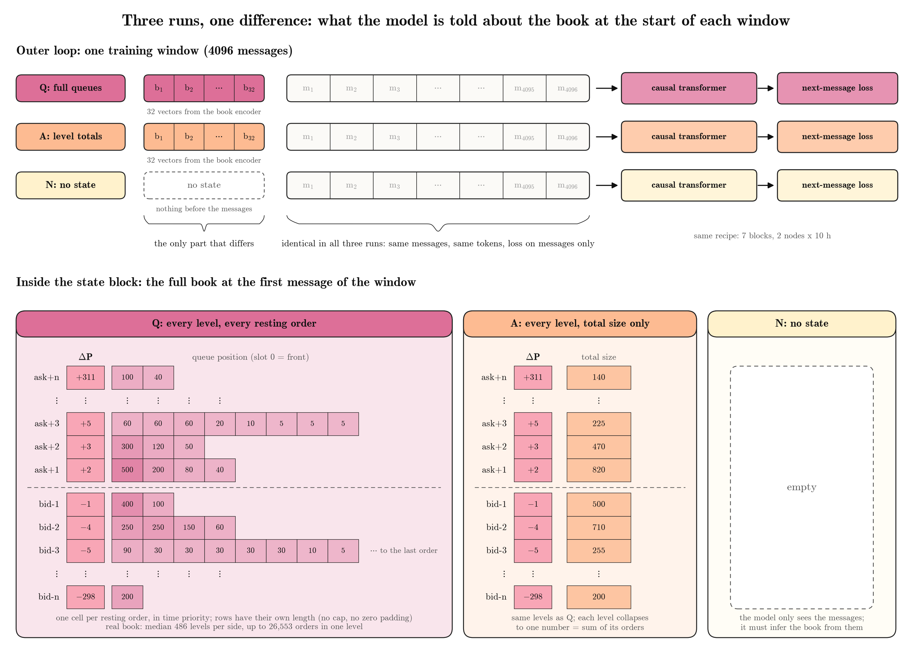
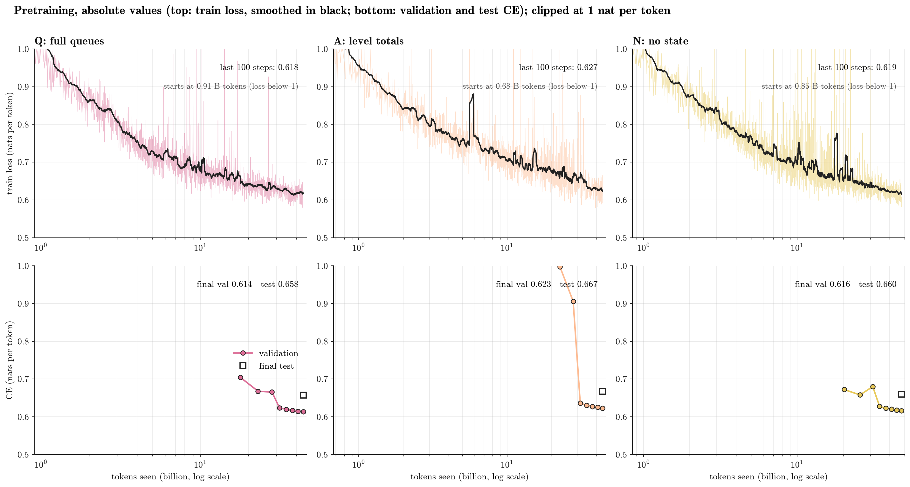
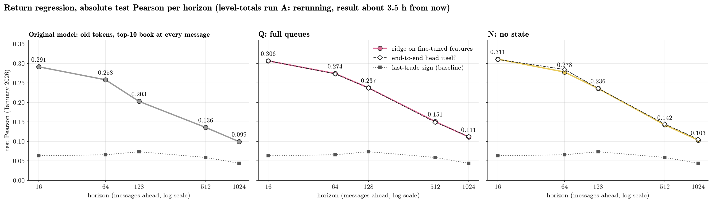

# How much book state does the model need? Full queues vs level totals vs none

[PR #1#1](https://github.com/bold-lab-ai/sigma-0/pull/1) proposes giving the model the order book once, at the start of each training window, and only messages after that (Scheme B). This PR tests how much that state block is worth.

## 1. Three runs, one difference

**Figure 1.** The three runs differ only in the state block placed before the 4096 messages of each training window:

- **Q (full queues):** every price level and every resting order in time priority, with no cap and no padding, encoded into 32 vectors.
- **A (level totals):** the same levels, but each level is reduced to its total resting size.
- **N (no state):** nothing before the messages.

Messages, tokenization, model size (7 blocks), training recipe (2 nodes × 10 h) and loss (next message only) are identical across the three runs.

## 2. Next-message loss

**Figure 2.** Training loss (top) and validation / test cross-entropy (bottom), in nats per token, against tokens seen (log scale).

- Q and N follow almost the same path and end within 0.002 nats per token of each other (test 0.658 vs 0.660).
- A's validation cross-entropy stays near 1.0 until about 25 billion tokens and then drops sharply to 0.62. A's final numbers are therefore not yet trusted.

## 3. Return prediction

**Figure 3.** Each pretrained model is fine-tuned end to end with a return head and scored by test Pearson correlation with future mid-price returns (January 2026, 70,185 decisions), at horizons of 16 to 1024 messages ahead.
