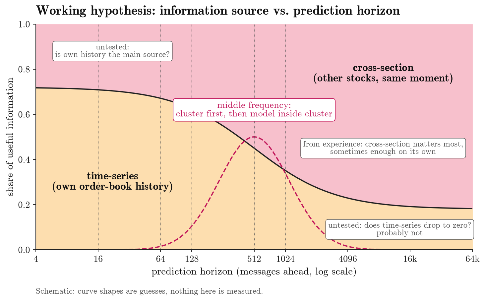
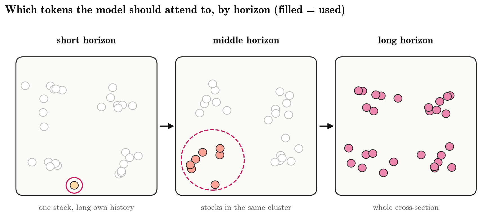
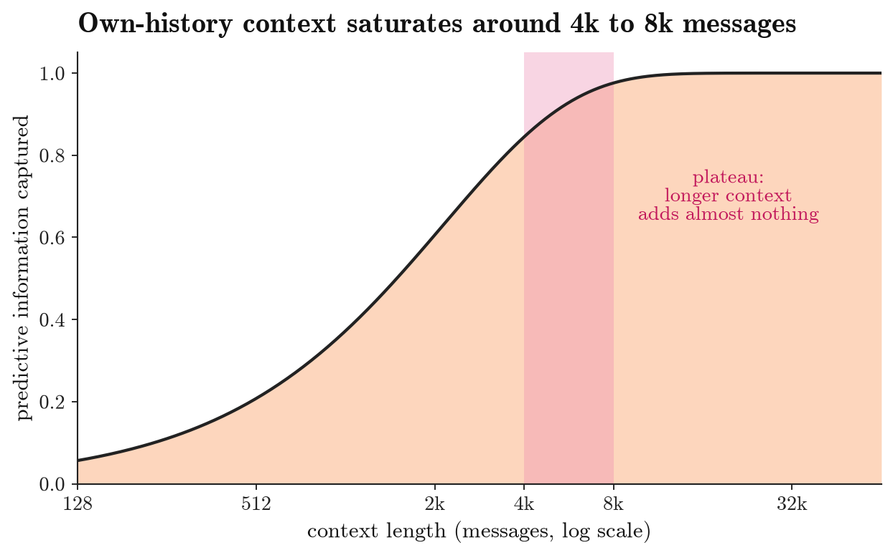
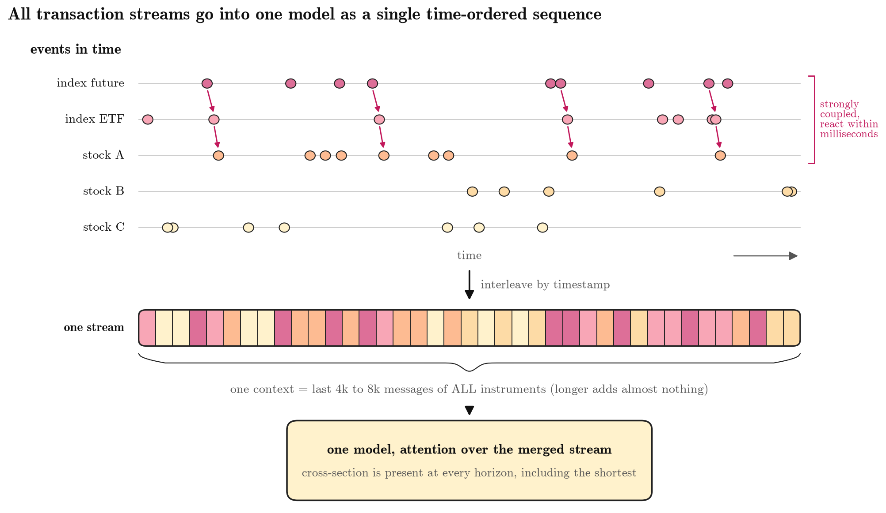

# Prediction horizon and where the information comes from

We want to find out, for each prediction horizon, where the useful information comes from: a stock's **own history** (time-series) or **what other stocks are doing at the same moment** (cross-section), and in what proportion. Only one point is backed by experience so far: **at long horizons cross-sectional information is important, and sometimes time-series is less needed**.

## What we know and what we want to test

From experience:

- Long horizons (1024 messages and beyond): cross-sectional information is important, and sometimes enough on its own.

To test:

- Short horizons (16, 64 messages ahead): is a stock's own history the main source? Is time-series alone enough? This has not been tested.
- Long horizons: does the time-series share drop to zero? We suspect it does not.
- Middle horizons (128, 512): is it enough to cluster stocks first and model within each cluster?
- Overall: how does the balance between time-series and cross-section change from short to long horizons?

## Which stocks the model should look at, by horizon

One guess to test: short term mainly the stock itself, middle term stocks in the same cluster, long term the whole market.

## Context saturates at around 4k to 8k messages

Looking further back adds almost no new information, so the budget is better spent on covering more instruments than on a longer history.

## Approach: merge all instruments into one time-ordered sequence for one model

- Closely linked instruments react to each other within milliseconds (red arrows), so even at the shortest horizon each stock should not be modelled in isolation.
- Transactions from all instruments are interleaved by timestamp into one sequence; one context is the most recent 4k to 8k messages across all instruments.
- The model attends over this merged sequence, so cross-sectional information is available at every horizon.
