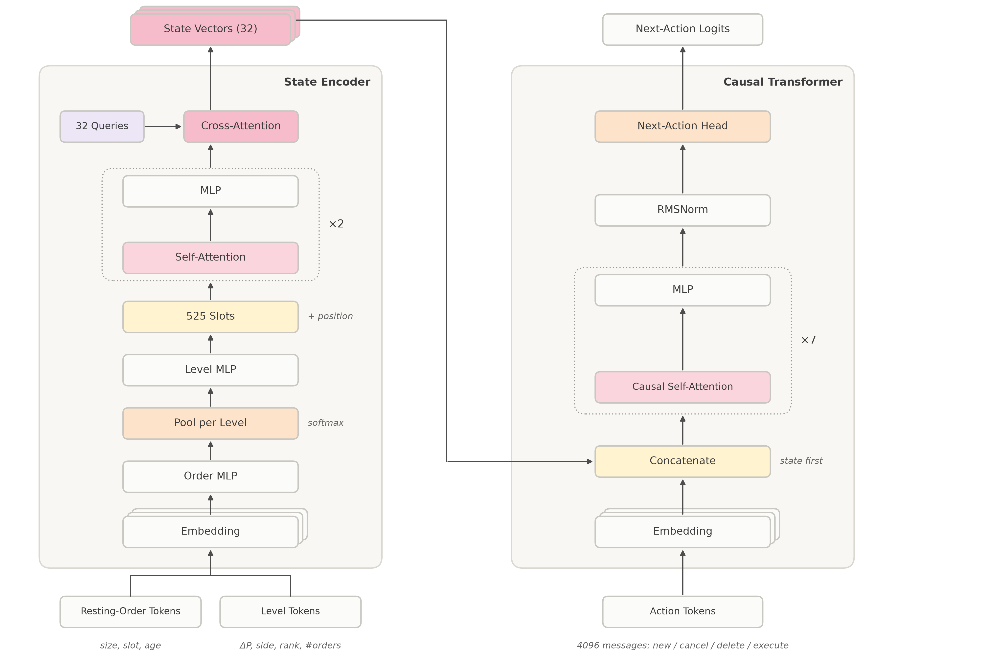
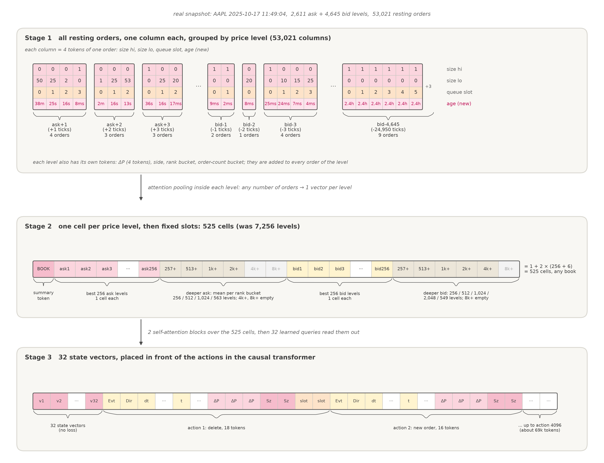
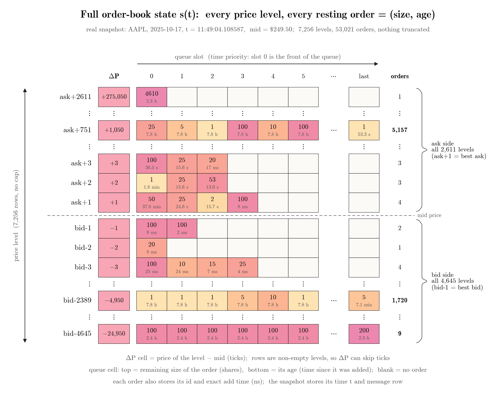
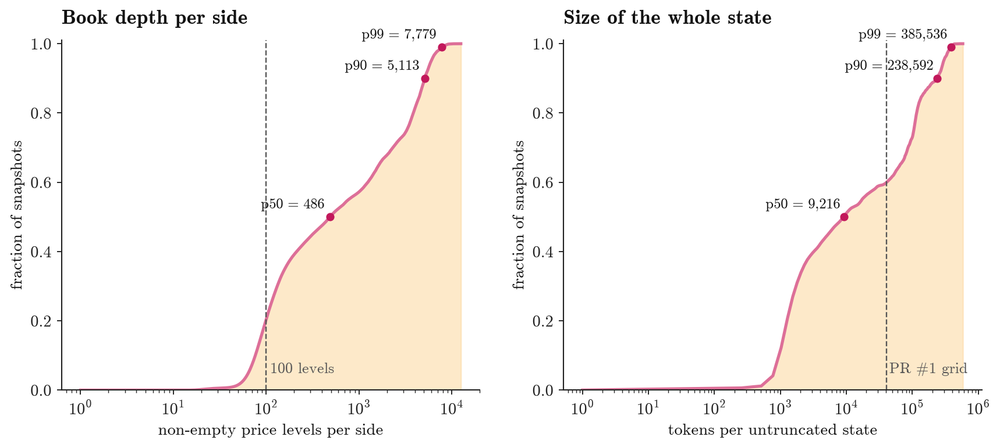
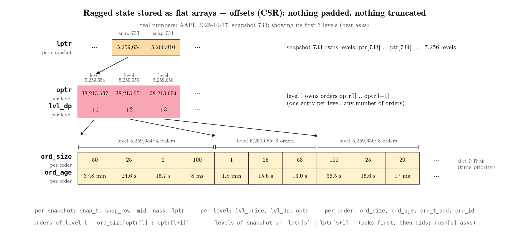
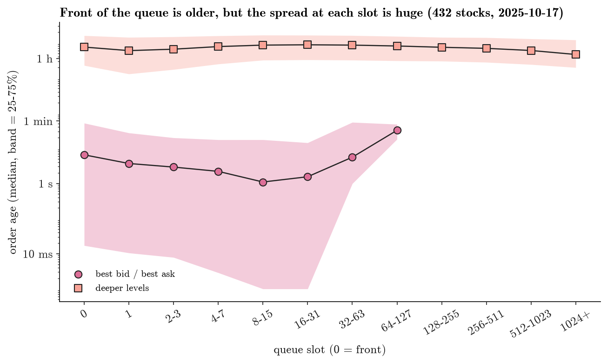
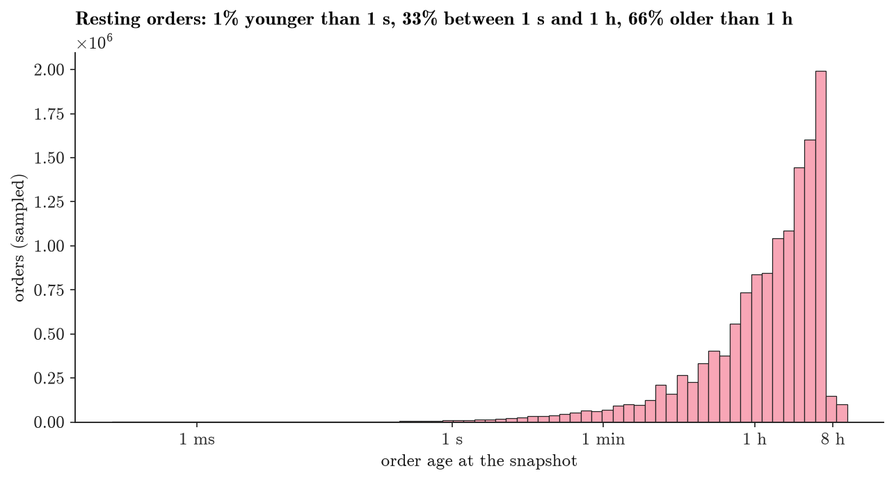
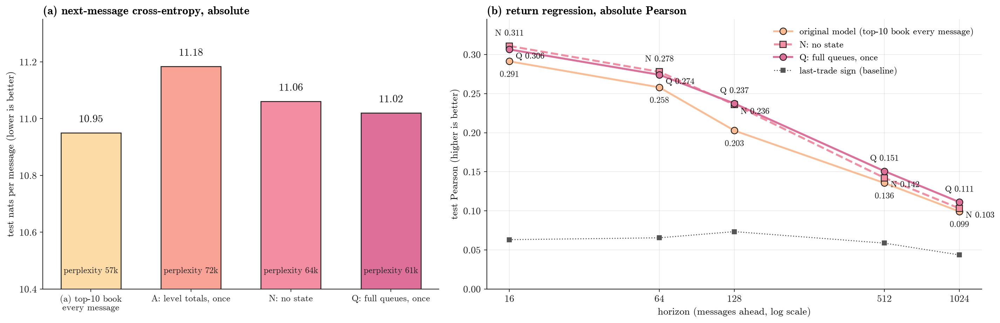

# New State: full queues + order age

In [PR #1#1](https://github.com/bold-lab-ai/sigma-0/pull/1) the state was a fixed 100 × 100 "price level × queue position" matrix. This PR replaces it with a new state:

- **Nothing is truncated.** Every price level on both sides is kept, and so is every resting order inside each level, in time priority.
- **One more field per resting order: its age**, i.e. how long it has been resting.
- **State and actions are encoded separately.** A State Encoder compresses the whole book into 32 vectors, which are placed in front of the action (message) sequence.

## 1. Architecture

**Figure 1: architecture.** On the left is the State Encoder:

- The inputs are, for each resting order, its size, queue position and age, and for each price level its ΔP, side, rank and number of orders.
- Orders are first pooled within their level with a softmax, then all levels are laid out as 525 slots.
- After 2 self-attention blocks, 32 learned queries read out 32 state vectors.

On the right is the causal Transformer. The 32 state vectors come first, followed by the action tokens of 4096 messages (new / cancel / delete / execute). After 7 layers the model predicts the next action.

**Figure 2: how the state enters the network.** This is one real snapshot (AAPL, 2025-10-17 11:49:04).

- **Stage 1:** each resting order is a column of 4 cells: size high part, size low part, queue position, age. Columns are grouped by price level, and the groups have different lengths.
- **Stage 2:** each price level is pooled into one cell. The 256 levels closest to the best price each get their own cell; deeper levels are pooled into buckets by rank (257+ … 8k+). With the BOOK cell, the two sides give 525 cells in total.
- **Stage 3:** the 32 state vectors plus the action tokens form the full sequence the model sees.

## 2. Why nothing is truncated

**Figure 3: one full snapshot.** Each row is a price level and each cell is one resting order; the top number is its size and the bottom number its age. This snapshot has 7,256 price levels, and its longest queue holds 5,157 orders.

**Figure 4: how large real books are.** Over 3.59 million snapshots of 432 stocks, 2025-10 to 2026-01:

- Queues near the best price are short, with a median of 2–3 orders.
- But 60% of resting orders sit at levels holding more than 100 orders.
- The median number of levels per side is 486, and the maximum is 12,491.

So a fixed 100 × 100 grid drops most resting orders.

## 3. Storage

**Figure 5: how the variable-length state is stored.** All resting orders are concatenated into one flat array, split by two levels of offsets: `lptr` gives the first level of each snapshot, and `optr` gives the first order of each level. No padding and no truncation.

## 4. Order age

**Figure 6: order age vs queue position (432 stocks, 2025-10-17).** At the best price, orders at the front of the queue are older: the median is about 5 s at slot 0 and about 1 s at slots 8–15. But at any single slot, age ranges from about 10 ms to over a minute, so it cannot be inferred from queue position; it is new information.

**Figure 7: distribution of order age.** 66% of resting orders have rested for more than 1 hour and 33% for between 1 s and 1 h; only 1% are younger than 1 s. The young orders are concentrated near the best price.

One day of data is ready: 2025-10-17, 432 stocks, 1.223 billion resting orders, each with its add time and none missing. Checks:

- Sizes match the existing state data order by order.
- Within a level, an order ahead in the queue was always added earlier, with no exceptions.
- No add time is later than its snapshot time.

## 5. Current results (full queues, no age yet)

Three runs, each 8 × GH200 for 10 hours, with the same recipe and data:

- **Q:** the full queues at the start of each window;
- **A:** only the total size per price level at the start of each window;
- **N:** no state.

**Figure 8: absolute results on the test set (2026-01).**

- **(a) Next-message cross-entropy** (nats per message, lower is better; perplexity = e^cross-entropy): Q 11.02, N 11.06, A 11.18. Scenario (a), which gives the top 10 levels at every message, is 10.95 and still the lowest.
- **(b) Return-regression Pearson** (higher is better): Q and N are above the original model at every horizon. At 128 messages, for example, Q is 0.237, N 0.236 and the original model 0.203. But the Q and N curves almost coincide.
