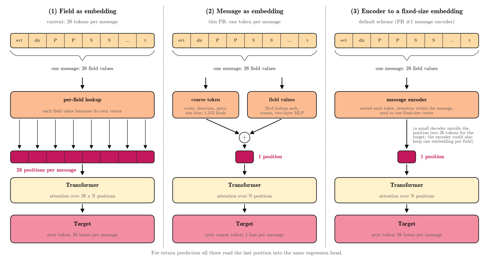
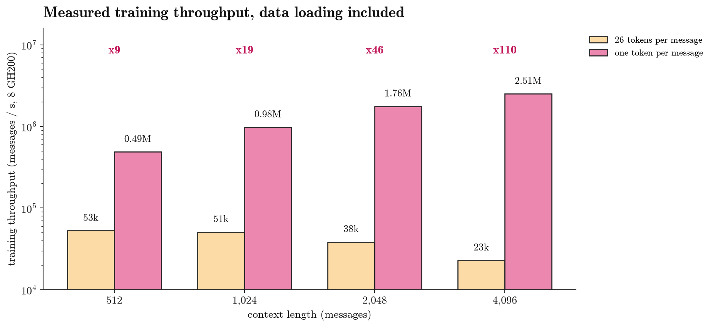

## Summary

This PR proposes to give each order-book message **one position** in the Transformer instead of 26, when the goal is return prediction rather than message generation.

1. **Input: one token per message.** All 26 field values of a message are still read. They are compressed into one vector, the message's embedding, *before* the Transformer: a coarse-token embedding plus a small MLP over the 26 field values. No information is dropped at the input.
2. **Target: the next message's coarse token.** Each position predicts one coarse token (1,152 kinds: event, direction, signed price bin, size bin, round lot). That is one loss per message instead of 26. The field values are input only.
3. **The rest is unchanged.** The Transformer (width 512, 6 layers) and the regression head that reads the last position to predict returns are the same.
4. **Why it is fast.** The Transformer sees 26x fewer positions, and attention cost grows with length. Measured training throughput is **110x higher** at a 4,096-message context, so one pass over 11.2 billion training messages drops from about **1,100 GPU-hours to about 10**.
5. **What it costs.** The model can no longer generate full messages (no rollout). For return prediction this is not needed.
6. **Open question this PR answers.** With the same pretraining compute, or with several passes over the data, does the cheaper model predict returns as well as the 26-token model? The return benchmark is running; results will be added to this PR when it finishes.

## 1. Representation

| | (1) Field as embedding | (2) Message as embedding (this PR) | (3) Encoder to a fixed-size embedding |
| --- | --- | --- | --- |
| How a message enters | each of the 26 fields is one token | coarse-token lookup + MLP over the 26 field values | a small encoder attends over the 26 tokens and pools them |
| Positions per message | 26 | 1 | 1 |
| Target | next token, 26 losses per message | next coarse token, 1 loss per message | next token, 26 losses per message |
| Extra part for the target | none | none | a small decoder unrolls the one position into 26 tokens |
| Status | current model | measured here | proposed in PR #1 |

Everything is trained end to end with the Transformer; nothing is pretrained separately. The model has 22.1 M parameters (the 26-token model: 29.2 M; the difference is the per-token output side).

## 2. Coarse token

The coarse token is computed from the 26 field values of the message, so no data pipeline change is needed.

| Field | Bins | Count |
| --- | --- | --- |
| Event | new order, cancellation, deletion, execution | 4 |
| Direction | buy, sell | 2 |
| Price vs. mid | sign: above, at or below | 2 |
| Price distance (ticks) | 0, 1, 2, 3, 4–5, 6–10, 11–50, 51–200, > 200 | 9 |
| Size (shares) | < 50, 50–99, 100–199, ≥ 200 | 4 |
| Round lot | size is a multiple of 100 | 2 |
| **Total** | 4 × 2 × 2 × 9 × 4 × 2 | **1,152** |

The bins follow LOBERT (Linna et al., 2025). The price bins extend further than in that paper because our price distances have a long tail (median 271 ticks). On 372 k real messages, 403 of the 1,152 kinds occur.

## 3. Speed

| | 26 tokens per message | One token per message |
| --- | --- | --- |
| Messages / s at 4,096 context (8 GH200) | 22.9 k | 2.51 M |
| GPU-hours per pass over 11.2 B messages | ~1,100 | ~10 |
| Passes in 80 GPU-hours | 0.11 | ~8 |

- Throughput includes data loading. Both models use the same batch (80 sequences of 4,096 messages per step) and the same optimiser settings.
- The gain grows with context length (9x at 512 messages, 110x at 4,096), because the 26-token model's attention runs over 26x longer sequences.
- In long two-node runs the one-token model ran slower than in Figure 2 (0.3–1.2 M messages/s). The cause is gradient synchronisation over TCP sockets between nodes: 32 ms per step. The cluster's libfabric network plugin cuts that to 0.9 ms. Enabling it in the training launcher is the next fix.
