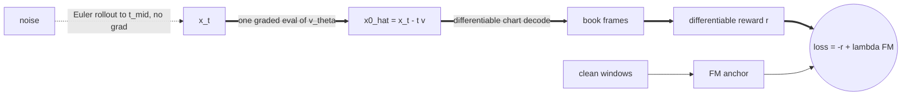
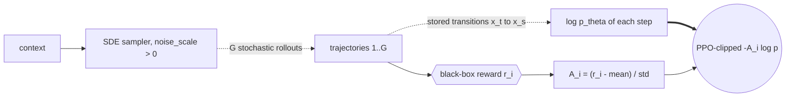
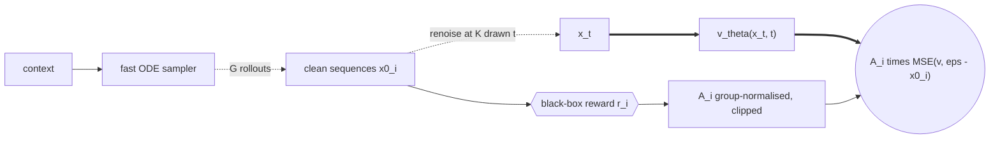
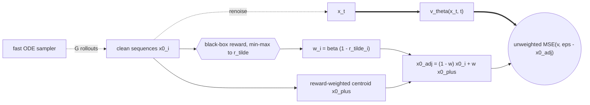
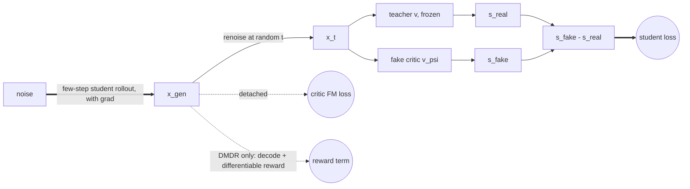

# Post-training the state model

The motivating picture is text-to-video alignment: the pretrained model can
roll a clip, post-training decides what a *good* clip is.  The running example
throughout the docstrings — "a cup is pushed off the table and must not
shatter" — maps onto the book as: the generated future must stay a valid,
statistically sane order book that follows its conditioning history.  The
constraint lives in the reward (or in the representation); none of these
methods can conjure it from nothing.

All four methods drive the same pretrained velocity model through
`state.flow.ModelFn`; they differ only in where the preference signal enters.

## The concrete step each file implements

| file | one training step | reward requirements |
|---|---|---|
| `refl.py` (ReFL) | roll part-way without gradients, one graded jump to `x0_hat`, descend on `-reward(x0_hat)`, plus a small FM anchor | differentiable |
| `flow_grpo.py` (Flow-GRPO / DanceGRPO) | G stochastic rollouts per context, group-normalised advantages, PPO-clipped `A_i * log p_theta(x_{t-dt} | x_t)` per kept transition | black box |
| `awm.py` (AWM) | same G rollouts (fast ODE), same advantages, but the loss is the pretraining FM regression weighted by `A_i` | black box |
| `ram.py` (RAM) | same G rollouts, plain unweighted FM loss, but the regression *endpoint* of a low-reward sequence is dragged toward the reward-weighted group centroid | black box |
| `dmd.py` (DMD / DMDR) | student rolls its own few-step clip (Self-Forcing blocks), teacher score vs fake-critic score at a random noise level, student descends along the gap; DMDR adds a ReFL-style reward term on the same rollout | none (DMD) / differentiable (DMDR) |

## The five mechanisms, drawn

One drawing per method.  Shared conventions: solid arrows are forward data
flow; dashed arrows are produced *without* gradients (rollouts treated as
data, detached tensors); thick arrows mark the edges the loss gradient flows
back along — they answer "which computation is actually being trained".
Hexagons are scorers the gradient never enters; double circles are losses.
The five differ in exactly one thing: where the preference signal enters —
through the reward's own gradient (ReFL), through a likelihood weight (GRPO),
through a loss weight (AWM), through the regression target (RAM), or through
a score-field difference with no reward at all (DMD).

### ReFL — the signal enters through the reward's gradient

The trajectory is data; only the last hop learns.  The reward must be
differentiable because the gradient literally passes through it.

### Flow-GRPO — the signal enters through weighted step likelihoods

Injected noise is what gives the G rollouts variance to rank; the reward
stays a black box — its number weights the likelihood, its gradient is never
asked for.  Every step of a good trajectory is reinforced equally.

### AWM — the signal enters as a loss weight

Same rollout data as GRPO, but the objective is pretraining's own regression:
positive advantage pulls the field toward that trajectory, negative pushes it
away.  No SDE, no per-step likelihoods.

### RAM — the signal enters through the regression target

The loss stays plain and unweighted; what moves is the endpoint it regresses
toward.  A shattered sequence no longer anchors the field at its own ending —
its target slides toward where the good rollouts ended.

### DMD — no reward: the signal is a score-field difference

Mass moves from where the student over-produces toward where the teacher says
real sequences live.  Nothing here says "unbroken" — if the teacher shatters
cups, so will the student; DMDR bolts the ReFL reward term onto the same
rollout for that.

## Choosing

| what you have | use |
|---|---|
| a working differentiable reward model, want prompt-following/looks fast | ReFL |
| only rules or black-box scores, and the per-step machinery is worth it | Flow-GRPO |
| same scores, but less compute and a loss that cannot fight pretraining | AWM or RAM |
| a strong multi-step teacher, a student that must run in few steps | DMD |
| a few-step student that must ALSO satisfy a constraint | DMDR |

Two contracts worth restating:

* **GRPO refuses a deterministic sampler.**  Without SDE exploration the G
  rollouts collapse onto nearly one path and the advantage has no variance;
  the constructor raises rather than letting that fail silently.
* **DMD alone cannot enforce validity.**  If the teacher pushes books through
  the ladder, the student learns the same violation — distribution matching
  reproduces the teacher, constraints enter via the reward (DMDR) or via the
  chart representation, which makes invalid books unrepresentable outright.

AWM vs RAM in one line: AWM keeps the target and multiplies the loss by a
signed advantage (it can actively push away); RAM keeps the plain loss and
rewrites the target's endpoint (every target stays a convex combination of
sampled endpoints, so it redirects but never diverges).

* **AWM needs its anchor for long runs.**  Measured on a full-day GOOG run
  (5,000-step pretrained base, 300 AWM steps): unanchored, the reward peaked
  near step 50 and then collapsed — group reward std fell 0.0046 -> 0.0005
  (all rollouts nearly identical) and the gain was given back; with
  ``fm_anchor_weight=0.25`` and real windows passed as ``data_batch``, the
  same 300 steps rose monotonically with group variance intact.

Credit assignment in GRPO is sequence-level here: one scalar per clip, every
step reinforced equally.  Splitting credit by timestep (the stepwise variant)
is left out deliberately — it changes the estimator, not the interface.
